# Implementation Plan: Technical Guide Alignment

**Project:** Satellite Collision Avoidance System (ICPS)  
**Document:** Implementation Plan & Execution Sequence  
**Reference:** `Satellite_Anti_Collision_Unreal_Engine_Technical_Guide.docx`  
**Working Directory:** `C:\Users\Sriram Krovi\satellite-collision-avoidance-system`  

---

## 1. Architectural Strategy & Safety Principles

1. **Non-Destructive Augmentation**: Existing D1 and D2 modules and tests remain untouched wherever possible. New capabilities are implemented as modular extensions.
2. **Opt-in Force Models**: Two-body Keplerian gravity ($\mu = 3.986004418 \times 10^{14}\text{ m}^3/\text{s}^2$) remains the authoritative default. Perturbations ($J_2$, atmospheric drag) are strictly opt-in.
3. **Truth vs. Observation Separation**: Sensor models generate noisy observations from truth trajectories; ML features use observations only.
4. **Untrusted ML Proposals**: All ML recommendations must pass deterministic physical and operational constraints before simulated execution.
5. **No Fake Results**: If no trained weights exist, implement a transparent heuristic baseline and label it as such.

---

## 2. Phase Execution Schedule

```mermaid
flowchart LR
    Phase1["Phase 1: Scientific Validation"] --> Phase2["Phase 2: Manoeuvre & Propulsion"]
    Phase2 --> Phase3["Phase 3: Sensor Simulation"]
    Phase3 --> Phase4["Phase 4: ML Service & Contract"]
    Phase4 --> Phase5["Phase 5: Unreal Integration"]
    Phase5 --> Phase6["Phase 6: Advanced Physics"]
    Phase6 --> Phase7["Phase 7: Scenarios S0-S8"]
    Phase7 --> Phase8["Phase 8: Evaluation & Metrics"]
    Phase8 --> Phase9["Phase 9: Final Audit & Report"]
```

### Phase 1: Scientific Validation & Numerical Quality
- Standardized numerical quality flags (`PSD_VALID`, `DEGENERATE_VELOCITY`, `NUMERICAL_UNDERFLOW`, `COVARIANCE_PROJECTED`).
- Automated RK4 step-size convergence test ($\mathcal{O}(h^4)$ scaling).
- Consequence indicators (relative kinetic energy, geometry characterization).
- Target: 100% pass on all existing tests + new validation tests.

### Phase 2: Manoeuvre and Propulsion Subsystem
- Finite-duration thrust model ($\mathbf{a}_{\text{thrust}} = \frac{T}{m(t)}\hat{\mathbf{u}}$).
- Dynamic propellant consumption & mass depletion via rocket equation ($\dot{m} = \frac{T}{I_{\text{sp}} g_0}$).
- Execution uncertainty model (Gaussian magnitude and pointing dispersion).
- Slew rate and physical manoeuvre constraints.
- Comparison with impulsive baseline.

### Phase 3: Sensor and Observation Simulation
- Modular `Sensors/` subsystem:
  - Optical sensor (Right Ascension / Declination line-of-sight with angular noise).
  - Radar sensor (Range and range-rate with noise and bias).
  - Ground station visibility pass (geodetic topocentric elevation mask).
  - Outage injection (deterministic dropout windows).
  - Strict truth vs. observation separation.

### Phase 4: Machine Learning Inference Service & Data Contract
- Standalone Python inference service with Pydantic/dataclass schemas matching Technical Guide Section 10.
- Input validation middleware (rejection of stale, malformed, wrong-frame data).
- Heuristic rule-based baseline model with model versioning.
- Pre-execution physical constraint verification.

### Phase 5: Unreal Engine Integration
- C++ `USensorVisualizerComponent` definition for FOV cone and tracking pass rendering.
- Extended `SimulationDataBridge` payload parser for sensor and ML metadata.
- HUD telemetry updates in `AvoidanceInfoPanelWidget`.

### Phase 6: Advanced Orbital Physics
- Earth $J_2$ equatorial bulge acceleration model.
- Exponential atmospheric drag acceleration model.
- Modular force-model accumulator interface in propagator.

### Phase 7: Scenarios S0–S8 Suite
- Standardized runnable scripts for scenarios S0 through S8.
- Comprehensive scenario execution runner.

### Phase 8: Evaluation, Metrics Suite & Logging
- Metrics calculation harness (`TCA error`, `miss distance error`, `Pc calibration`, `FPR`, `FNR`, `lead time`, `fuel cost`, `runtime`).
- Structured JSON and CSV logging.

### Phase 9: Final Independent Audit & Reporting
- Independent audit against 12-page guide.
- Production of `FINAL_COMPLETION_REPORT.md` and `FINAL_COMPLETION_AUDIT.md`.
