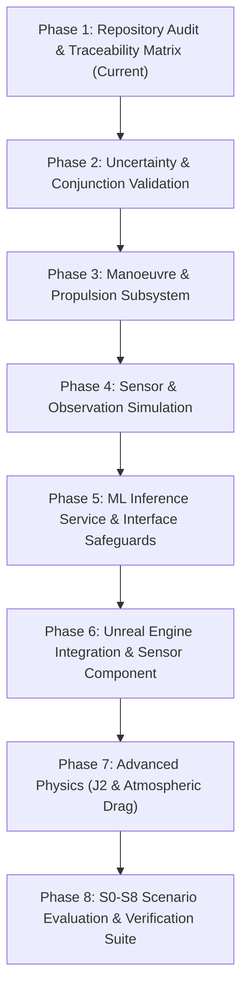

# Satellite Anti-Collision Simulation: Requirement Traceability Matrix & Implementation Plan

**Document Version:** 1.0  
**Date:** 22 November 2026  
**Reference Document:** `Satellite_Anti_Collision_Unreal_Engine_Technical_Guide.docx` (Version 1.0, 18 November 2026)  
**Target Repository:** `C:\Users\Sriram Krovi\satellite-collision-avoidance-system` (`main` branch)  
**Safety Classification:** Educational & Research Simulation Prototype (Non-flight software; no operational certification claimed)

---

## Executive Summary & System Audit

An exhaustive audit of the `satellite-collision-avoidance-system` repository was conducted against the 12-page *Satellite Anti-Collision Simulation Technical Development Guide*.

### Current System Health & Baseline Preservation
1. **D1 Baseline**: Real TLE ingestion (CARTOSAT-3, PSLV R/B debris), SGP4 orbital propagation, trajectory export (`orbital_states.csv`), and 2D matplotlib simulation.
2. **D2 Scientific Core**: Rigorous, double-precision two-body orbital dynamics, Runge-Kutta 4 (RK4) integrator, 42-state Variational State Transition Matrix (STM) propagation, analytical linear CPA, numerical parabolic-refined TCA, 6×6 covariance validation and propagation, Foster (1992) 2D encounter-plane collision probability ($P_c$) solver with asymptotic tail underflow preservation, local RTN frame transformations, discrete candidate manoeuvre generation, multi-criteria manoeuvre optimization, and post-burn re-screening.
3. **Test Suite Status**: **39 of 39 pytest tests in `D2/tests` pass with zero failures (100% pass rate)**.
4. **Reference Scenario Invariants**:
   - Nominal TCA: $769.63\text{ s}$
   - Nominal miss distance: $1563.48\text{ m}$ ($< 2000\text{ m}$ threshold)
   - Nominal $P_c$: $3.958 \times 10^{-14}$ (`NUMERICAL_UNDERFLOW` preserved)
   - Selected Manoeuvre: `MAN_006_-R_3.00mps_T170s` (radial inward burn $-3.00\text{ m/s}$, burn epoch $t = 169.63\text{ s}$)
   - Post-manoeuvre TCA: $903.03\text{ s}$ ($+133.40\text{ s}$ shift)
   - Post-manoeuvre miss distance: $2454.42\text{ m}$ ($+890.94\text{ m}$ clearance)
   - Post-manoeuvre $P_c$: $1.239 \times 10^{-22}$ ($8.50$ orders of magnitude reduction)
   - Trajectory deviation at nominal TCA: $2018.99\text{ m}$ ($69.0\%$ radial, $31.0\%$ along-track)
   - Peak trajectory deviation: $3008.50\text{ m}$ (at $t = 1000\text{ s}$)
5. **Unreal Engine 5.7.4 Integration**: C++ actors (`EarthActor`, `SatelliteActor`, `DebrisActor`), visualizers (`OrbitPathActor`, `ConjunctionVisualizer`, `ManoeuvreVisualizer`), UMG HUD (`AvoidanceInfoPanelWidget`), simulation manager (`OrbitSimulationManager`), and coordinate adapter (`CoordinateAdapter`) operating at visual scale $0.01\text{ uu/m}$ ($1\text{ uu} = 100\text{ m}$).

---

## Requirement Traceability Matrix (RTM)

The matrix below maps every section, subsection, and technical rule from the 12-page Technical Development Guide to its implementation status, existing code, test coverage, and remaining work.

**Classification Scheme:**
- **IMPLEMENTED**: Fully implemented, mathematically validated, and backed by passing automated tests.
- **PARTIAL**: Partially implemented in existing D1/D2 code or UE, requiring extensions or formalized modular isolation.
- **MISSING**: Specified in the guide but not yet implemented in the repository.
- **NOT APPLICABLE (N/A)**: Purely architectural guidance, advisory note, safety boundary statement, or literature citation.

| Section | Guide Requirement & Specification | Classification | Existing Repository Code / Artifacts | Existing Test Coverage | Gaps & Action Required |
| :--- | :--- | :--- | :--- | :--- | :--- |
| **Doc Purpose** | Educational/research boundary; not flight software; clear safety disclaimers. | **IMPLEMENTED** | `README.md`, `FINAL_QUALITY_REVIEW.md`, `Final_Technical_Report.md`. | N/A (Doc inspection) | Maintain explicit disclaimers across all new code, schemas, and reports. |
| **Outcomes** | 1. Propagate protected sat & secondary objects. | **IMPLEMENTED** | `D2/dynamics/orbit_propagator.py`, `D2/dynamics/two_body.py`. | `D2/tests/test_orbit_propagation.py`, `test_two_body.py`. | Fully covered for two-body. |
| **Outcomes** | 2. Calculate TCA, miss distance, relative encounter velocity. | **IMPLEMENTED** | `D2/conjunction/tca.py`, `D2/conjunction/screening.py`. | `D2/tests/test_conjunction.py`. | Fully covered. |
| **Outcomes** | 3. Represent uncertainty & calculate $P_c$ or clear risk proxy. | **IMPLEMENTED** | `D2/uncertainty/covariance.py`, `D2/uncertainty/collision_probability.py`. | `D2/tests/test_uncertainty.py`, `test_orbital_covariance.py`. | Fully covered for Foster (1992). Add formal numerical quality flags. |
| **Outcomes** | 4. Receive prediction/risk/decision from external ML service. | **MISSING** | None. (Only batch JSON export exists). | None. | Build Python ML service (`MLService/`) with versioned REST/JSON schema. |
| **Outcomes** | 5. Apply physically constrained avoidance manoeuvre & re-screen. | **IMPLEMENTED** | `D2/manoeuvres/avoidance_pipeline.py`, `manoeuvre_evaluator.py`. | `D2/tests/test_manoeuvres.py`. | Impulsive verified; finite-duration thrust and execution uncertainty to be added. |
| **Outcomes** | 6. Visualize and log events for scenario comparison and replay. | **PARTIAL** | `unreal_simulation_payload.json`, `Encounter_Summary.csv`, UE5 HUD. | `D2/tests/test_visualization.py`. | Expand logging to reproducible S0–S8 scenario runners and metrics suite. |
| **Sec 1** | System architecture and subsystem responsibility boundaries. | **IMPLEMENTED** | Modular directory structure (`D2/dynamics`, `conjunction`, `uncertainty`, `manoeuvres`, `visualization`). | `test_visualization.py` (`test_scientific_solver_separation`). | Maintain strict separation of concerns. Scientific solver remains authoritative. |
| **Sec 1** | Unreal rigid-body physics MUST NOT be authoritative orbit propagator. | **IMPLEMENTED** | `OrbitSimulationManager.cpp`, `CoordinateAdapter.cpp`. Unreal only consumes sampled spline snapshots. | `test_visualization.py`. | Preserved as invariant. No rigid-body gravity in UE. |
| **Sec 2.1** | Reference frames: Declared ECI frame, SI units ($m, m/s$), explicit epoch. | **IMPLEMENTED** | `two_body.py`, `tca.py`, `coordinate_transform.py`. ECI J2000 declared in metadata. | `test_visualization.py`, `test_two_body.py`. | Preserved across all modules and schemas. |
| **Sec 2.1** | ECEF frame for Earth-fixed features with time-dependent transform. | **PARTIAL** | Basic Earth rotation in `EarthActor.cpp`. | None for ground stations. | Formalize ECI $\leftrightarrow$ ECEF rotation for ground sensor passes. |
| **Sec 2.1** | Single simulation clock; UTC epoch / elapsed time; frame rate $\neq$ physics step. | **IMPLEMENTED** | `OrbitSimulationManager.cpp` (`CurrentSimulationTime`), `times` array in Python. | `test_visualization.py`. | Kept synchronized in data contracts. |
| **Sec 2.1** | Double precision for all orbital dynamics calculations. | **IMPLEMENTED** | Python `np.float64` across all scientific modules; C++ `double` in adapters. | All 39 tests. | Preserved as invariant. |
| **Sec 2.1** | Convert ECI/ECEF to UE display in one unified adapter. | **IMPLEMENTED** | `D2/visualization/coordinate_transform.py` & `UCoordinateAdapter.cpp`. | `test_visualization.py`. | Preserved as single point of conversion. |
| **Sec 2.2** | Render scale definition ($0.01\text{ uu/m}$) and "NOT TO SCALE" indicator. | **IMPLEMENTED** | `coordinate_transform.py`, `AvoidanceInfoPanelWidget.cpp` (`NOT TO SCALE` label). | `test_visualization.py`. | Preserved as invariant. |
| **Sec 3.1** | Two-body point-mass gravity: $\mathbf{a} = -\mu \mathbf{r}/\|\mathbf{r}\|^3$. | **IMPLEMENTED** | `D2/dynamics/two_body.py` (`gravitational_acceleration`). | `D2/tests/test_two_body.py`. | Invariant baseline. |
| **Sec 3.1** | Circular orbit checks: $v = \sqrt{\mu/r}$, $T = 2\pi\sqrt{r^3/\mu}$. | **IMPLEMENTED** | `D2/scenarios/close_approach.py`, `D2/dynamics/two_body.py`. | `D2/tests/test_two_body.py`. | Invariant baseline. |
| **Sec 3.2** | Numerical ODE integration: RK4 implementation with convergence verification. | **IMPLEMENTED** | `D2/dynamics/rk4.py` (`rk4_step`). | `D2/tests/test_rk4.py`. | Fixed-step RK4 validated. Add step-size convergence test suite & adaptive-step option. |
| **Sec 3.3** | Earth $J_2$ non-spherical equatorial bulge perturbation. | **MISSING** | Not present in `two_body.py`. | None. | Implement $J_2$ acceleration model in `D2/dynamics/perturbations.py`. |
| **Sec 3.3** | Atmospheric drag perturbation (density model, area, $C_d$, mass). | **MISSING** | Not present in `two_body.py`. | None. | Implement atmospheric exponential drag model in `D2/dynamics/perturbations.py`. |
| **Sec 3.3** | Solar radiation pressure, third-body gravity, eclipses (higher fidelity). | **NOT APPLICABLE** | Progressive additions for higher fidelity/cislunar cases; out of LEO scope. | N/A | Document as future extension; focus on $J_2$ and drag for LEO. |
| **Sec 3.3** | Thrust perturbation (velocity change for avoidance). | **IMPLEMENTED** | Impulsive $\Delta v$ in `manoeuvre_model.py`. | `test_manoeuvres.py`. | Retain impulsive as baseline; add finite-duration thrust acceleration model. |
| **Sec 4** | Satellite and debris object model (ID, epoch, frame, state, mass, HBR, cov, Cd, area). | **PARTIAL** | D2 models dictionary states with mass/HBR/covariance. Lacks formalized class hierarchy. | `test_close_approach.py`, `test_manoeuvres.py`. | Formalize comprehensive `SpaceObject` dataclass matching Table in Sec 4. |
| **Sec 4.1** | Geometry: separate visual mesh size from physical hard-body radius ($R_{\text{HBR}}$). | **IMPLEMENTED** | `hard_body_radius = 5.0m` in solver, UE meshes scaled for visual clarity. | `test_visualization.py`. | Preserved as invariant. |
| **Sec 4.2** | Debris population: synthetic known states, orbital mechanics propagation. | **IMPLEMENTED** | Synthetic LEO debris (`close_approach.py`) & TLE debris (`data_loader.py`). | `test_close_approach.py`. | Extend to multi-debris catalog scenario (S5). |
| **Sec 5.1** | Relative state: $\mathbf{r}_{\text{rel}} = \mathbf{r}_2 - \mathbf{r}_1, \mathbf{v}_{\text{rel}} = \mathbf{v}_2 - \mathbf{v}_1$. | **IMPLEMENTED** | `D2/conjunction/tca.py` (`calculate_relative_state`). | `D2/tests/test_conjunction.py`. | Fully covered. |
| **Sec 5.2** | Closest Point of Approach (linear CPA) with window & near-zero $v_{\text{rel}}$ safe handling. | **IMPLEMENTED** | `D2/conjunction/tca.py` (`calculate_linear_cpa`). | `D2/tests/test_conjunction.py`. | Fully covered. |
| **Sec 5.3** | Time of Closest Approach (numerical TCA) with parabolic sub-step refinement. | **IMPLEMENTED** | `D2/conjunction/tca.py` (`calculate_numerical_tca`). | `D2/tests/test_conjunction.py`. | Fully covered. |
| **Sec 5.4** | Screening volume as computational filter (default $25\text{ km}$), distinct from $P_c$. | **IMPLEMENTED** | `D2/conjunction/screening.py` (`screen_conjunction`). | `D2/tests/test_conjunction.py`. | Fully covered. |
| **Sec 6.1** | Covariance representation ($6\times 6$ $P$), symmetry and PSD validation. | **IMPLEMENTED** | `D2/uncertainty/covariance.py` (`validate_covariance`). | `D2/tests/test_uncertainty.py`. | Fully covered. |
| **Sec 6.1** | Relative covariance under independent-error assumption ($P_{\text{rel}} = P_1 + P_2$). | **IMPLEMENTED** | `D2/uncertainty/covariance.py` (`combine_covariances`). | `D2/tests/test_uncertainty.py`. | Fully covered. |
| **Sec 6.1** | Covariance propagation: $P(t) = \Phi(t, t_0) P(t_0) \Phi(t, t_0)^T + Q$. | **IMPLEMENTED** | `D2/uncertainty/covariance.py` & `D2/dynamics/variational.py`. | `D2/tests/test_orbital_covariance.py`. | Fully covered. |
| **Sec 6.2** | Probability of Collision ($P_c$): 2D encounter-plane projection & Foster (1992) integration. | **IMPLEMENTED** | `D2/uncertainty/collision_probability.py`. | `D2/tests/test_uncertainty.py`. | Validated. Add standardized numerical quality flags. |
| **Sec 6.2** | Missing covariance handling: Never assume zero uncertainty; label risk proxy. | **IMPLEMENTED** | `calculate_simplified_risk_proxy()`, status `COVARIANCE_UNAVAILABLE`. | `D2/tests/test_uncertainty.py`, `test_manoeuvres.py`. | Fully covered. |
| **Sec 6.3** | Risk vs Probability: Separate likelihood ($P_c$) from consequences (speed, mass). | **PARTIAL** | Separate $P_c$ and miss distance; consequence metrics (relative kinetic energy) not explicit. | `test_uncertainty.py`. | Add explicit encounter consequence indicators (relative energy, mass index). |
| **Sec 7.1** | Delta-v and thrust: Impulsive $\Delta v$ baseline; finite-duration thrust acceleration. | **PARTIAL** | Impulsive $\Delta v$ implemented in `manoeuvre_model.py`. | `D2/tests/test_manoeuvres.py`. | Add finite-duration burn propagator and compare with impulsive baseline. |
| **Sec 7.2** | Rocket equation: $\Delta v = I_{\text{sp}} g_0 \ln(m_0 / m_f)$, propellant consumption. | **PARTIAL** | Analytical formula cited in report; dynamic mass depletion not integrated into solver. | Doc review. | Integrate rocket equation mass depletion into propulsion module. |
| **Sec 7.3** | Manoeuvre constraints: $T_{\max}$, duration, available fuel, slew rate, execution error. | **PARTIAL** | Constraints in `ManoeuvreConstraints` include $\Delta v_{\max}$, lead time, deviation. | `D2/tests/test_manoeuvres.py`. | Add fuel limit, slew rate limits, and execution dispersion/uncertainty ($\sigma_{\Delta v}, \sigma_{\theta}$). |
| **Sec 7.4** | Manoeuvre evaluation loop: receive proposal, validate, apply, propagate, re-screen. | **IMPLEMENTED** | `D2/manoeuvres/avoidance_pipeline.py`. | `D2/tests/test_manoeuvres.py`. | Retain existing loop; support finite burn and multi-target re-screening. |
| **Sec 8** | Sensor simulation: separate ground-truth and observed states. | **MISSING** | No sensor subsystem exists. Solvers currently take exact initial states. | None. | Build `Sensors/` subsystem: optical, radar, ground station passes, noise & outages. |
| **Sec 8** | Measurement error sources: noise, bias, visibility windows, timestamps, quality flags. | **MISSING** | None. | None. | Implement Gaussian noise, measurement bias, orbital line-of-sight tracking geometry. |
| **Sec 9** | Unreal Engine actors: Manager, Earth, Sat, Debris, Path, Conjunction & Manoeuvre Visualizers. | **IMPLEMENTED** | `AOrbitSimulationManager`, `AEarthActor`, `ASatelliteActor`, `ADebrisActor`, `AOrbitPathActor`, etc. | `test_visualization.py`. | Invariant core. |
| **Sec 9** | Sensor visualizer component: `USensorVisualizerComponent` (FOV, rays, coverage). | **MISSING** | None in UE source. | None. | Add `USensorVisualizerComponent` to Unreal C++ actors and data bridge. |
| **Sec 9.1** | Rendering guidance: Local origin, sampled trails, visual differentiation, NOT TO SCALE indicator. | **IMPLEMENTED** | Implemented across UE materials, actors, and HUD. | Visual audit / `visual_scene_audit.json`. | Preserved as invariant. |
| **Sec 10** | Python–Unreal data contract: versioned JSON schema (10.1 input, 10.2 response). | **PARTIAL** | Data bridge payload format exists (`1.0`), but live ML service schema not formalized. | `test_visualization.py`. | Formalize OpenAPI / Pydantic versioned JSON schemas for ML service. |
| **Sec 10.3** | Interface safeguards: Reject stale, malformed, wrong-frame; validate proposals before execution. | **MISSING** | No live API server exists. | None. | Implement validation middleware in Python ML service. |
| **Sec 11** | S0: Circular orbit scenario (analytical speed, period, solver sanity). | **PARTIAL** | Validated in `test_two_body.py`. | `test_two_body.py`. | Build standalone runnable scenario `Scenarios/s0_circular_orbit.py`. |
| **Sec 11** | S1: Elliptical orbit scenario (nonzero eccentricity, vis-viva, apogee/perigee). | **MISSING** | No dedicated scenario script. | None. | Build standalone runnable scenario `Scenarios/s1_elliptical_orbit.py`. |
| **Sec 11** | S2: Close approach scenario (TCA and miss distance). | **IMPLEMENTED** | `D2/scenarios/close_approach.py`. | `test_close_approach.py`, `test_conjunction.py`. | Wrap into standardized `Scenarios/s2_close_approach.py`. |
| **Sec 11** | S3: Uncertain conjunction scenario (covariance, noisy observations, risk). | **PARTIAL** | Tested in `test_manoeuvres.py`. | `test_manoeuvres.py`. | Build standalone runnable scenario `Scenarios/s3_uncertain_conjunction.py`. |
| **Sec 11** | S4: Avoidance burn scenario (burn execution, post-burn re-screening). | **IMPLEMENTED** | D2 baseline reference scenario. | `test_manoeuvres.py`. | Wrap into standardized `Scenarios/s4_avoidance_burn.py`. |
| **Sec 11** | S5: Multiple debris scenario (1 primary sat, $N$ debris objects, multi-screening). | **MISSING** | Only 1 debris object in D2 baseline. | `test_batch_catalog_screening` (partial). | Build standalone runnable scenario `Scenarios/s5_multiple_debris.py`. |
| **Sec 11** | S6: Perturbed LEO scenario (point-mass vs $J_2$ + atmospheric drag). | **MISSING** | No perturbation models. | None. | Build standalone runnable scenario `Scenarios/s6_perturbed_leo.py`. |
| **Sec 11** | S7: Sensor outage scenario (observation dropout, tracking gap, covariance growth). | **MISSING** | No sensor simulator. | None. | Build standalone runnable scenario `Scenarios/s7_sensor_outage.py`. |
| **Sec 11** | S8: Safe pass scenario (near miss geometry, safe miss distance $> 2000\text{ m}$). | **PARTIAL** | Tested in `test_conjunction.py` (`test_safe_pass`). | `test_conjunction.py`. | Build standalone runnable scenario `Scenarios/s8_safe_pass.py`. |
| **Sec 12.1** | Physics validation: Units/frame checks, analytical checks, step convergence, covariance PSD. | **IMPLEMENTED** | Extensive tests in `D2/tests`. | `test_two_body.py`, `test_rk4.py`, `test_uncertainty.py`. | Add explicit step-size convergence test across multiple integration steps. |
| **Sec 12.2** | Metrics suite: TCA error, miss error, $P_c$ calibration, FPR, FNR, lead time, risk reduction, $\Delta v$, runtime. | **PARTIAL** | Baseline evaluation calculates $\Delta d$, $\Delta \text{TCA}$, $\Delta P_c$, $\Delta v$, deviation. | `Project_Deliverables/Final_Milestone/Performance_Evaluation.csv`. | Implement formal metrics computation harness `Evaluation/metrics_suite.py`. |

---

## Phased Implementation Sequence

The work is organized into 8 modular, independently testable phases matching the technical guide roadmap and the user prompt.

### Detailed Phase Breakdown

#### Phase 1: Audit Existing Implementation (COMPLETED)
- **Scope**: Inspect full repository, baseline D1/D2 modules, Unreal actors and shaders, tests, deliverables, and the technical guide.
- **Deliverables**: Traceability matrix, gap analysis, and implementation plan.
- **Invariants**: No changes to existing code. All 39 D2 regression tests confirmed passing.

#### Phase 2: Uncertainty & Conjunction Validation
- **Scope**:
  - Add standardized numerical quality flags (`PSD_VALID`, `DEGENERATE_VELOCITY`, `NUMERICAL_UNDERFLOW`, `COVARIANCE_PROJECTED`) to $P_c$ calculation.
  - Implement step-size convergence test helper to verify numerical error scaling $\mathcal{O}(h^4)$ for RK4.
  - Add explicit encounter consequence indicators (relative kinetic energy, encounter geometry characterization).
- **Files Affected**:
  - `D2/uncertainty/collision_probability.py` (extend return dictionary with standardized quality flags)
  - `D2/tests/test_uncertainty.py` (add quality flag verification tests)
  - `D2/tests/test_rk4.py` (add convergence test verifying truncation error scaling)
- **Scientific Invariants**: Exact Foster (1992) $P_c$ values for reference scenario ($3.958 \times 10^{-14}$ nominal, $1.239 \times 10^{-22}$ post-manoeuvre) must remain identical.

#### Phase 3: Manoeuvre and Propulsion Subsystem
- **Scope**:
  - Retain impulsive $\Delta v$ as the validated baseline.
  - Implement finite-duration thrust model: continuous thrust acceleration $\mathbf{a}_{\text{thrust}} = \frac{T}{m(t)} \hat{\mathbf{u}}$ over duration $\Delta t_{\text{burn}} = m_p / \dot{m}$.
  - Dynamic mass depletion: $\dot{m} = \frac{T}{I_{\text{sp}} g_0}$, $m(t) = m_0 - \dot{m} t$.
  - Tsiolkovsky ideal rocket equation validation: $\Delta v = I_{\text{sp}} g_0 \ln(m_0 / m_f)$.
  - Manoeuvre execution uncertainty model: Gaussian perturbations on burn magnitude ($\sigma_{\Delta v}$) and pointing angle ($\sigma_{\theta}$).
  - Realistic operational constraints: maximum thrust, minimum impulse bit, attitude slew rate limit.
- **Files Affected**:
  - New module: `D2/manoeuvres/propulsion.py`
  - Update: `D2/manoeuvres/manoeuvre_model.py` (add finite burn parameters and execution uncertainty)
  - New tests: `D2/tests/test_propulsion.py`
- **Scientific Invariants**: Impulsive manoeuvre `MAN_006_-R_3.00mps_T170s` and all 12 tests in `test_manoeuvres.py` must continue passing without modification.

#### Phase 4: Sensor and Observation Simulation
- **Scope**:
  - Build standalone `Sensors/` subsystem maintaining strict separation between ground-truth and observed states.
  - Simulated measurement models:
    1. Optical tracking: Right Ascension / Declination ($\alpha, \delta$) or line-of-sight unit vector with angular Gaussian noise.
    2. Radar tracking: Range ($r$) and range-rate ($\dot{r}$) with measurement noise and range bias.
    3. Ground tracking pass: Visibility windows based on ground station geodetic position and elevation mask ($> 10^\circ$).
    4. Onboard GNSS/navigation: Spacecraft state estimate with bias, drift, and estimation covariance.
  - Sensor metadata: timestamps, sensor ID, frame (ECI/topocentric), noise parameters, quality flags.
  - Sensor outage generator: dropout windows, missing observations, corrupted frames.
- **Files Affected**:
  - New directory: `Sensors/` (`sensor_base.py`, `optical_sensor.py`, `radar_sensor.py`, `ground_station.py`, `observation_generator.py`)
  - New tests: `tests/test_sensors.py`
- **Scientific Invariants**: Scientific solvers continue to take authoritative SI state inputs; ground truth is never leaked into the observation pipeline.

#### Phase 5: Machine Learning (ML) Inference Service
- **Scope**:
  - Build standalone Python service (`MLService/`) implementing the versioned request/response contract specified in Technical Guide Section 10.
  - Input schema: `schema_version`, `scenario_id`, `epoch_utc`, `frame`, `primary`, `secondary`, `observation_source`.
  - Output schema: `schema_version`, `scenario_id`, `prediction` (`tca_seconds`, `miss_distance_m`, `collision_probability`, `risk_class`), `recommended_action` (`type`, `epoch_offset_seconds`, `delta_v_mps`, `frame`), `model_version`.
  - Interface safeguards:
    - Rejection of stale, malformed, or wrong-frame messages.
    - Timestamp and unit validation.
    - Safety rule: **Never execute an ML manoeuvre proposal without physics and constraint validation** in the astrodynamics engine.
  - Baseline model implementation: clearly labelled deterministic heuristic baseline (no fabricated accuracy claims).
- **Files Affected**:
  - New directory: `MLService/` (`schemas.py`, `inference_service.py`, `baseline_model.py`, `client.py`)
  - New tests: `tests/test_ml_service.py`

#### Phase 6: Unreal Engine Integration & Sensor Visualization
- **Scope**:
  - Add `USensorVisualizerComponent` to Unreal C++ codebase for rendering sensor field of view (FOV), observation rays, and tracking passes.
  - Update `SimulationDataBridge` to ingest sensor observation streams, ML prediction metadata, and validation quality flags.
  - Update `AvoidanceInfoPanelWidget` to display sensor health/outage status, ML model version, and manoeuvre validation status.
  - Update `unreal_simulation_payload.json` schema to include sensor observations and ML proposal comparison.
- **Files Affected**:
  - `UnrealProject/Source/SatelliteAvoidance/Visualization/SensorVisualizerComponent.h/cpp` (new)
  - `UnrealProject/Source/SatelliteAvoidance/DataBridge/SimulationDataBridge.h/cpp` (extended)
  - `UnrealProject/Source/SatelliteAvoidance/UI/AvoidanceInfoPanelWidget.h/cpp` (extended)
  - `D2/visualization/simulation_exporter.py` (extended payload generator)

#### Phase 7: Advanced Orbital Physics (Progressive Perturbations)
- **Scope**:
  - Implement Earth $J_2$ non-spherical equatorial bulge perturbation:
    $$\mathbf{a}_{J2} = -\frac{3}{2} J_2 \frac{\mu R_E^2}{r^4} \left[ \left( 1 - 5 \frac{z^2}{r^2} \right) \frac{\mathbf{r}}{r} + 2 \frac{z}{r} \hat{\mathbf{z}} \right]$$
    where $J_2 = 1.08263 \times 10^{-3}$, $R_E = 6378137.0\text{ m}$.
  - Implement atmospheric drag perturbation:
    $$\mathbf{a}_{\text{drag}} = -\frac{1}{2} \rho(h) \frac{C_d A}{m} \|\mathbf{v}_{\text{rel}}\| \mathbf{v}_{\text{rel}}$$
    with exponential atmospheric density model: $\rho(h) = \rho_0 \exp(-(h - h_0)/H)$.
  - Progressive force model framework: forces can be enabled or disabled cleanly via flags without modifying the two-body baseline.
- **Files Affected**:
  - New module: `D2/dynamics/perturbations.py`
  - Update: `D2/dynamics/orbit_propagator.py` (support optional perturbing acceleration callbacks)
  - New tests: `D2/tests/test_perturbations.py`
- **Scientific Invariants**: Baseline two-body gravity ($\mathbf{a} = -\mu \mathbf{r}/r^3$) remains the exact default; all 39 existing tests continue to pass with perturbations disabled.

#### Phase 8: Scenarios S0–S8 & Comprehensive Evaluation Suite
- **Scope**:
  - Implement reproducible runnable configurations for all 9 guide scenarios:
    - **S0**: Circular Orbit (speed $7546.05\text{ m/s}$, period $5828.52\text{ s}$, energy conservation).
    - **S1**: Elliptical Orbit ($e = 0.05$, perigee/apogee vis-viva verification).
    - **S2**: Close Approach (controlled two-body encounter, baseline geometry).
    - **S3**: Uncertain Conjunction (covariance propagation, observation noise, $P_c$ evaluation).
    - **S4**: Avoidance Burn (impulsive and finite burn, post-burn re-screening).
    - **S5**: Multiple Debris (1 primary satellite, 10 debris objects, catalog screening).
    - **S6**: Perturbed LEO (two-body vs $J_2$ + drag secular decay and nodal precession).
    - **S7**: Sensor Outage (tracking loss during encounter, covariance dilation).
    - **S8**: Safe Pass (close geometry but miss distance $> 2000\text{ m}$, proximity $\neq$ risk).
  - Metrics evaluation suite (`Evaluation/metrics_suite.py`):
    - TCA error, miss-distance error, $P_c$ calibration, FPR, FNR, decision lead time, risk reduction factor, $\Delta v$ budget, propellant mass, execution runtime.
  - Generate reproducible scenario execution logs (`Results/scenarios_s0_s8.json`, CSVs).
- **Files Affected**:
  - New directory: `Scenarios/` (`s0_circular.py` through `s8_safe_pass.py`, `run_all_scenarios.py`)
  - New directory: `Evaluation/` (`metrics_suite.py`, `scenario_evaluator.py`)
  - New tests: `tests/test_scenarios.py`
- **Deliverables**: Final validation report, updated README, and updated technical deliverables.

---

## Architectural Invariants & Safety Protocols

1. **Strict Solver Separation**: Unreal Engine 5 is strictly a visual telemetry client. It never runs rigid-body physics for orbital calculations.
2. **SI Units & Declared ECI Frame**: All authoritative orbital states remain in metres, metres per second, and UTC epoch in ECI J2000.
3. **No Fabricated Data**: No artificial ML accuracies, synthetic $P_c$ results, or fictitious sensor numbers will be stated.
4. **Distinction Between Risk Score and $P_c$**: When covariance is absent, outputs will be explicitly marked as `COVARIANCE_UNAVAILABLE` and labeled as a geometric risk proxy.
5. **Non-Flight Certification**: Software remains an educational and academic research prototype; flight readiness is never claimed.
